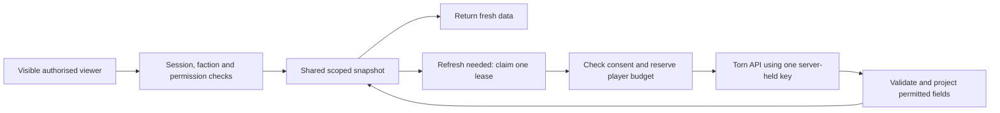

# Shared Torn API capacity: research and proposed design

Researched: 20 October 2026.

Status: implemented as a same-faction, opt-in pool. Existing keys are not
enrolled. See [deployment and use](shared-api-key-pool.md) for schema setup,
contribution controls, current limits and validation boundaries. The sections
below preserve the research and design rationale; proposed future extensions
are not automatically enabled.

## Recommendation

Build a server-side request broker with a shared faction cache and optional,
explicitly consented key contributions. Fetch a faction snapshot once and serve
it to every authorised viewer. Rotate the upstream work fairly between eligible
contributors only when a refresh is necessary. Players receive data; they never
receive another player's key.

Start with separate pools for each faction. A later community pool could cover
explicitly allowlisted public data, but needs its own consent scope and response
projections. Personal endpoints always use the requesting player's own key.

Pooling spreads the remaining work. Caching removes unnecessary work. Both are
needed to reduce player quota usage without sacrificing useful freshness.

## Research findings

Other tools publicly document this pattern:

| Service | Documented approach |
| --- | --- |
| [Torn Command Center](https://www.ashborne.party/privacy/) | Pools members' keys for their own faction, with faction isolation and identifiable request comments. |
| [TornManager Recruiter](https://tornmanager.com/legal) | Uses a server-side public-key pool, one contributed key per player, request comments, and removal controls. |
| [KAL](https://kalends.dev/api-policy) | Documents a public-selection pool, an opt-out, and separate explicit consent for future non-public selections. |
| [Torning](https://torn.ing/terms) | Discloses community public-data requests and contributions to the key owner's faction reads. |

These are the operators' published policies, not independent security audits
or proof of Torn approval for a different service.

[Torn's API rules](https://www.torn.com/api.html) currently specify:

- A ceiling of 100 requests per minute **per player, across all their keys**;
  limits can change.
- Confidential handling of keys and data, with conspicuous disclosure of
  storage, sharing, purpose, key handling, and required access at submission.
- Invalid/disabled keys must be removed from use; repeated invalid requests can
  cause an IP block.
- Service-cached requests can repeat data for up to 30 seconds. A unique
  `timestamp` can bypass that cache; service-cache hits do not consume quota.
  Globally cached selections cannot be made fresher by switching keys.

The recommendation here is an engineering interpretation of those constraints,
not a blanket permission to collect keys or evade limits. Chainward should
publish the precise use before enrolling anyone and resolve uncertain expanded
uses with Torn staff.

## What the repository already has

| Area | Current implementation | Consequence for pooling |
| --- | --- | --- |
| Stored keys | `src/lib/security/credential-encryption.ts` uses AES-256-GCM; remembered keys use a dedicated encryption secret. | Reuse the storage boundary; keep decryption confined to trusted server code. |
| Credentials | `FactionApiCredential` in `prisma/schema.prisma` records owner Torn ID, faction, encrypted key, selections, status, and validation/error timestamps. | Useful starting point, but there is no pool consent, shared quota ledger, or refresh lease. |
| Caching | `src/lib/torn/client.ts` keys its process-local cache and in-flight requests by credential fingerprint and URL. | Different players requesting the same faction data do not share these entries; server instances also have separate maps. |
| Active chain | `src/lib/torn/polling-policy.ts` currently sets a five-second active cadence. Fresh telemetry bypasses the local cache and requests an upstream timestamp. | Up to 12 chain reads per minute per active player before retries and other features. Older documentation mentioning ten seconds is stale. |
| Incoming limits | `src/lib/security/rate-limit.ts` and the telemetry route constrain incoming traffic in process memory. | They do not enforce an aggregate upstream budget across every endpoint, worker, key, and instance for a player. |
| Push monitoring | `src/lib/notifications/push-dispatcher.ts` selects the most recently updated active stored credential for each subscribed faction (`take: 1`). | Some faction background work already uses a member's key. There is no fair rotation or separate contribution consent check in this selection. |
| Presence | Remembered session `lastSeenAt` is refreshed at most once per day. | It is session maintenance, not evidence that someone is viewing the app now. |
| Key guidance | `src/components/onboarding/api-key-help-dialog.tsx` has a brief optional help dialog and recommends Limited access. | Pooling needs conspicuous purpose/access disclosure and an explicit contribution control at key submission and in Settings. |

Authentication must remain independent of the donor selected for a read. The
previous security audit documents a critical shared-key authentication fallback
that was removed. A broker must never restore that behaviour.

## Request flow

1. Resolve the requesting user's session and authorise the exact feature,
   faction, membership, and active licence before donor selection or refresh.
   Apply permission checks to cached responses too. Do not derive the viewer's
   identity or role from the donor's profile or permissions.
2. Map a typed operation to an allowlisted endpoint, entity and response scope.
   Resolve faction IDs from trusted server context. Do not expose an arbitrary
   URL, selection, donor-ID, or cache-bypass proxy to the browser.
3. Read the shared snapshot. Fresh data costs no Torn call. Concurrent ordinary
   reads, manual refreshes, page renders, and workers join the same refresh.
4. On expiry, atomically claim one short, bounded refresh lease. Recheck the
   cache after claiming it. Select an eligible donor with the lowest recent
   usage relative to their contribution allowance; rotate ties.
5. Reserve all applicable budgets before each upstream attempt, including
   retries. Decrypt only the selected key, send it in the `Authorization`
   header, and attach an identifiable `chainward` comment.
6. Validate the response and requested entity, construct an allowlisted data
   object, and store it with scope, schema version, receipt time and expiry.
   Release the lease. Never replace a good snapshot with an error.

Use the existing PostgreSQL deployment for initial shared snapshots, leases,
quota reservations and cooldowns. Transactions and row locks must make budget
checks atomic across instances, with a consistent lock order. Do not hold a
database transaction open during the Torn network request. Lease ownership
tokens/fencing must prevent an expired worker overwriting a newer result.

If shared coordination is unavailable, serve eligible cached data or report
temporary unavailability. Falling back to independent per-instance budgets
would defeat the protection. Redis is a later scaling option, not an initial
dependency. Keep local SQLite development explicitly outside multi-instance
production guarantees.

## Which requests may share capacity

The [official OpenAPI specification](https://www.torn.com/swagger/openapi.json),
version 6.13.8 when checked, describes the faction operations below as public-key
accessible. However, ongoing chain reports are restricted to the key owner's
faction. `basic.is_enlisted` and member `revive_setting` also depend on faction
permissions. Therefore, endpoint access level alone is insufficient to decide
whether an entire response is interchangeable.

| Operation | Initial donor scope | Response/cache scope |
| --- | --- | --- |
| `/faction/{id}/chain` | Consenting, verified members of the requested faction | Faction ID and operation; one shared current-chain snapshot. |
| `/faction/{id}/basic`, `/faction/{id}/members` | Same faction | Explicit common-field projection; permission-dependent fields require a separate authorised projection and cache scope. |
| `/faction/{id}/chains` | Same faction | Faction ID plus canonical pagination/filter parameters. |
| `/faction/{chainId}/chainreport` | Same faction; bind the chain ID to that faction | Faction ID, chain ID and live/final state. A chain ID is not a faction ID. |
| `/user/{id}/profile`, target bounties | Owner's key initially; optional public pool later | Explicit target ID and public-field projection. Personal target lists and notes retain their own permissions. |
| `/key/info`, `/user/basic`, `/user/profile` for identity | The connecting player's own key | Credential/owner scoped; never replace with a donor response. |
| `/user/battlestats`, `/user/attacks`, `/user/events` | The requesting player's own key | Owner and capability scoped; excluded from the shared pool. |
| FFScouter or other third-party integrations | Existing separately disclosed integration | Never forward a pool contributor's Torn key to another provider. |

Do not remove the credential fingerprint from every existing cache key. Some
schemas retain unknown fields, and valid responses can contain extra data for
more privileged keys. Explicit field selection is required before shared
storage. Include visibility/capability scope and projection version in cache
keys. Keep personal and faction-private data out of any global public cache.

## Consent and contributor eligibility

Offer an unchecked control such as: "Contribute up to 10 Torn requests per
minute to refresh shared data for my faction." This is a proposed product
default, not a Torn limit. Explain the exact endpoints, beneficiaries, retention,
offline use, and that calls count against the player's quota across other apps.
Existing remembered keys start unenrolled.

Prefer a separate Public-access contribution key, or a verified custom key
limited to the required selections. A Limited login key need not become a pool
key. A separate key improves permission isolation but adds no Torn quota.
Initially select at most one contribution credential per player.

Persist a versioned grant referencing the encrypted credential, verified owner,
faction, allowed operations, acceptance time, cap, offline-contribution choice,
and revocation time/version. Store full namespaced capability metadata rather
than only a flat faction-selection list. A scope expansion requires fresh
acceptance. An administrator cannot opt in someone else's key.

Before dispatch, require active consent, a healthy credential, sufficient
capabilities, fresh membership verification, available budget, and no cooldown.
Positive roster removal disables contributions immediately. An unavailable
membership check must not extend a contribution indefinitely: give verification
a short maximum age and stop donor eligibility when it expires. This is stricter
than the current interactive authorisation path's outage-tolerant roster check.

Pool opt-out stops new reservations without deleting the login credential.
Disconnect, key deletion, replacement, or faction departure invalidates grants
and queued work across instances. Recheck grant version immediately before
dispatch. A request already sent to Torn cannot be recalled; disclose that
boundary. Never reactivate an invalidated grant merely because a key is saved
again. Keep revocation tombstones effective after backup restoration.

## Online demand and freshness

"Online" should mean a visible, connected Chainward view requesting a specific
feature. It need not mean that the contributor is currently playing Torn.
Renew an authenticated feature-demand lease about every 15 seconds while
visible; expire it after approximately 45 seconds without renewal. Hidden or
closed tabs stop renewing. Aggregate multiple tabs and sessions so they do not
multiply upstream work. Presence is a scheduling hint, never authorisation.

Refresh only demanded features. With no viewers, foreground refreshes stop after
leases expire. Existing push alerts are a separate background demand: preserve
them only with explicit monitoring authorisation and an eligible contribution
grant covering background use. Do not silently disable alerts when the last
viewer leaves or silently enrol every login key in background monitoring.

Whether a donor must also be online is a separate preference. Default to
contributions while they are active; allow offline contribution only when
explicitly selected. An offline donor can then help active viewers without
creating needless polling for an empty workspace.

Proposed initial refresh policy:

| Data | Refresh policy |
| --- | --- |
| Active chain | At most once every five seconds per faction, shared across viewers and workers. |
| Idle chain | Every 30-60 seconds while demanded; slower preferences may apply. |
| Faction identity and common roster | 30-60 seconds while demanded; membership safety expiry applies separately. |
| Completed-chain list | Approximately ten minutes, plus bounded refresh after chain completion. |
| Ongoing report | 15-30 seconds while viewed. |
| Finalized report | Persist after confirmed completion; explicit bounded resync for corrections. |

Manual "Sync now" joins the same lease and minimum interval. It cannot create
extra timestamp-bypassed calls per viewer. Keep the existing server-measured
`dataAgeMs` and monotonic client countdown. Distinguish response receipt time
from upstream observation time; a freshly received service-cached response can
still contain old data. Use the supported cache bypass only where freshness
requires it, and display stale/degraded status on failed refreshes. Expired
membership evidence must not authorise sensitive cached responses.

Illustration, excluding other endpoints and retries: twenty players each
checking a chain every five seconds can generate 240 calls/minute. One shared
faction refresh needs 12. With five eligible contributors, that averages 2.4
chain calls/minute each; exact distribution follows the scheduler and caps.
Polling frequency is a target, not a guarantee of instantaneous Torn data.

## Quota protection and failures

Use durable budgets keyed by **owner Torn ID**, spanning all their credentials
and factions. Account for foreground reads, personal reads, onboarding after
owner resolution, push monitoring and retries. Apply global/egress and
per-faction budgets as well; do not invent a guaranteed Torn IP allowance.
Unknown-owner onboarding needs its existing abuse limits and a small separate
bootstrap budget until identity is verified.

Suggested starting policy: a hard sliding-window maximum of 30 Chainward calls
per player per 60 seconds, with contributions capped at 10 within that total,
and paced dispatch with minimal bursts. Players can lower their contribution
allowance. Count every actual attempt conservatively, even if Torn might serve
it from cache; do not refund timeouts. All existing direct call paths must use
the same accounting before claiming a total cap is enforced.

Chainward cannot reserve the remaining capacity against Torn PDA, other tools,
or manual calls. It must not promise that a player can never hit Torn's limit.
Do not probe spare capacity with extra calls or repeatedly poll key logs to
estimate it. When insufficient capacity remains, lengthen refresh intervals
and show the last update time rather than increase donor caps automatically.

| Result | Broker action |
| --- | --- |
| Incorrect, inactive or paused credential | Stop using that credential; require owner correction/revalidation. |
| Permission/relation error | Stop that operation for the credential; revalidate capability/membership without exposing another scope's data. |
| Player rate limit | Cool down the owner across every key; no immediate retry with another key belonging to that player. |
| Daily read limit | Suspend the affected owner/read class until the applicable reset; exclude history jobs from the initial pool. |
| IP block | Open a shared egress circuit breaker; switching keys must not continue traffic through the block. |
| Torn outage or repeated network failure | Bounded backoff with jitter and a shared circuit breaker; preserve labelled cached data. |

Handle HTTP failures even when the body is not Torn JSON. Honour a valid
`Retry-After` as a minimum delay; it can contain seconds or an HTTP date under
[RFC 9110](https://www.rfc-editor.org/rfc/rfc9110.html#section-10.2.3).
Persist long cooldowns instead of sleeping inside a web request. The current
client caps retry delays at five seconds and treats player/IP/daily limits as
retryable, so it needs revision before a broker can safely manage these cases.

## Secret handling and operational controls

Keep plaintext keys out of browser responses, logs, URLs, telemetry, queue
payloads and exception details. Reference credentials by internal ID in jobs.
Use HTTPS, validate upstream certificates, and restrict the production broker's
outbound destination to Torn; the existing configurable API base URL must not
redirect pooled credentials to an arbitrary host.

Retain authenticated encryption with fresh nonces. Store master secrets in
managed secret storage separately from database backups, limit decryption
rights, and plan versioned rotation. For a new encryption format, bind owner,
faction and credential ID as authenticated context to resist ciphertext swaps.
Encryption at rest does not protect against a compromised process that can
decrypt keys; endpoint allowlisting and least privilege remain necessary.
These controls follow [OWASP's secrets-management guidance](https://cheatsheetseries.owasp.org/cheatsheets/Secrets_Management_Cheat_Sheet.html).

Record request metadata only: operation, scope, internal contributor reference,
reason, attempt count, duration and outcome. Give owners their own usage
counters, recent purposes, configured cap, consent status and stop control.
Expose aggregate pool health to faction administrators without revealing keys
or other players' personal activity. Set a proposed 30-day metadata retention
and document backup retention/deletion behaviour before release.

## Implementation order and acceptance checks

1. Define typed operations, response projections and explicit scopes. Add the
   shared cache/refresh leases behind a disabled feature flag; retain owner-key
   authentication. Audit every Torn caller, including authorization and workers.
2. Add central attempt accounting and correct cooldowns to all call paths.
   Measure actual upstream usage and duplicate suppression.
3. Add encrypted contribution credentials, versioned grants and conspicuous
   disclosure. Enrol only explicit opt-ins; offer opt-out independently of login.
4. Route faction telemetry, roster/history and authorised background monitoring
   through the broker. Enable a small same-faction pilot with conservative caps.
5. Consider a separate public community pool only after its exact operations,
   field projections, consent and purpose have been reviewed.

Required verification before enabling:

- Two authorised players with different keys share one faction refresh; two
  instances cannot spend the same lease or exceed a player's sliding window.
- Twenty viewers and a push pass share one due chain refresh; simultaneous
  manual refreshes and extra tabs cannot multiply it.
- Personal data, permission-dependent fields, identities and faction records
  never cross their defined scopes; a donor's privileges never become a viewer's.
- Invalid keys, paused keys, owner-wide limits, daily limits, IP blocks, non-JSON
  HTTP errors and long `Retry-After` values produce the expected cooldown.
- Opt-out, replacement, faction departure and disconnect stop queued/new work;
  expired leases, server crashes and restored backups cannot revive permission.
- Hidden/closed views expire demand; authorised background alerts continue only
  under their own demand and contribution permissions.
- Missing shared storage or no eligible donors produces bounded stale data or
  an unavailable state; logs, payloads and error responses contain no keys.

This research used published primary sources and read-only code inspection.
No live player key, quota, or production pool was tested.
